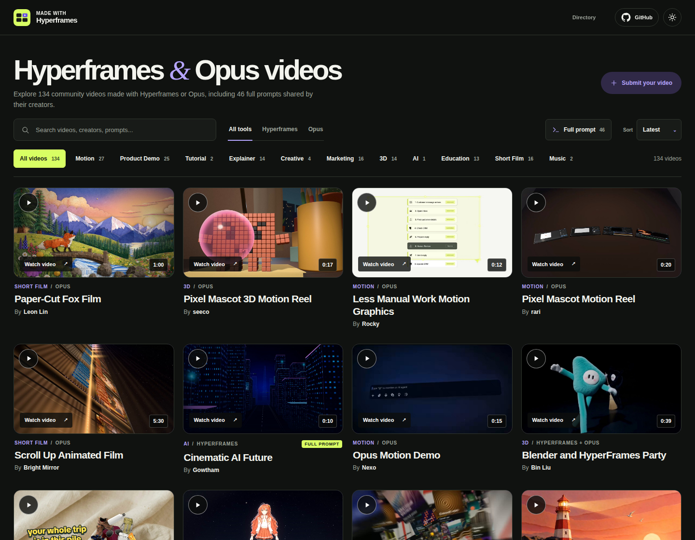

<h1 align="center">Awesome HyperFrames</h1>

<p align="center">
  <a href="https://github.com/dev-gowtham08/awesome-hyperframes/actions/workflows/validate-directory.yml"></a>
</p>

<p align="center">
  Videos made with code. The creators and prompts behind them.<br>
  <sub>Featuring HyperFrames, Opus, Remotion, and more.</sub>
</p>

<p align="center">
  <a href="https://madewithhyperframes.com"><strong>▶ Watch the collection</strong></a>
  &nbsp; · &nbsp;
  <a href="DIRECTORY.md">Browse all videos</a>
  &nbsp; · &nbsp;
  <a href="https://github.com/dev-gowtham08/awesome-hyperframes/issues/new?template=video-submission.md">Submit yours</a>
</p>

<p align="center">
  <a href="https://madewithhyperframes.com">
    
  </a>
  <br>
  <sub><a href="https://madewithhyperframes.com">madewithhyperframes.com</a> · Watch, explore, and find your next idea.</sub>
</p>

<!-- BEGIN DIRECTORY SUMMARY -->

<p align="center">
  <strong>258</strong> videos &nbsp; · &nbsp; <strong>79</strong> with published prompts &nbsp; · &nbsp; <strong>179</strong> with context or excerpts
</p>

## Browse by category

<table>
  <tr>
    <td width="33%" align="center"><a href="#product-demos"><strong>Product demos</strong></a><br><sub>46 videos · <a href="DIRECTORY.md#product-demos">View all</a></sub></td>
    <td width="33%" align="center"><a href="#motion-and-creative"><strong>Motion and creative</strong></a><br><sub>80 videos · <a href="DIRECTORY.md#motion-and-creative">View all</a></sub></td>
    <td width="33%" align="center"><a href="#explainers-and-education"><strong>Explainers and education</strong></a><br><sub>49 videos · <a href="DIRECTORY.md#explainers-and-education">View all</a></sub></td>
  </tr>
  <tr>
    <td width="33%" align="center"><a href="#3d-scenes"><strong>3D scenes</strong></a><br><sub>18 videos · <a href="DIRECTORY.md#3d-scenes">View all</a></sub></td>
    <td width="33%" align="center"><a href="#launches-and-marketing"><strong>Launches and marketing</strong></a><br><sub>35 videos · <a href="DIRECTORY.md#launches-and-marketing">View all</a></sub></td>
    <td width="33%" align="center"><a href="#short-films-and-music"><strong>Short films and music</strong></a><br><sub>30 videos · <a href="DIRECTORY.md#short-films-and-music">View all</a></sub></td>
  </tr>
</table>

<!-- END DIRECTORY SUMMARY -->

Previews open on **madewithhyperframes.com**. **Original** links to the creator’s post; prompt and context links open the stored text. Highlights prioritize HyperFrames creations, with each video’s tools shown below it.

<!-- BEGIN VIDEO SHOWCASE -->

## Product demos

| **Onde Fica App Motion Reel** | **HyperFrames Video Polish Demo** | **Made With Hyperframes Directory Walkthrough** |
| --- | --- | --- |
| [](https://madewithhyperframes.com/projects/jesscaroline7-955094) | [](https://madewithhyperframes.com/projects/video-polish-demo-quiet-ad) | [](https://madewithhyperframes.com/projects/made-with-hyperframes-walkthrough-gowtham) |
| By [jesscaroline7](https://x.com/jesscaroline7) | By [Quiet-Ad-2239](https://www.reddit.com/user/Quiet-Ad-2239/) | By [Gowtham](https://x.com/gowthamtj0808) |
| HyperFrames + Opus · 1:00 | HyperFrames · 1:49 | HyperFrames · 0:36 |
| [Watch](https://madewithhyperframes.com/projects/jesscaroline7-955094) · [Original](https://x.com/jesscaroline7/status/2104336637752955094/video/1) · [Starting prompt](data/projects.json#L785) · [Source](https://x.com/jesscaroline7/status/2104336637752955094) | [Watch](https://madewithhyperframes.com/projects/video-polish-demo-quiet-ad) · [Original](https://www.reddit.com/r/hyperframes/comments/1xzn56p/i_made_a_hyperframes_video_polish_skill_so_an/) · [Context](data/projects.json#L3619) | [Watch](https://madewithhyperframes.com/projects/made-with-hyperframes-walkthrough-gowtham) · [Original](https://x.com/gowthamtj0808/status/2116171243468759525/video/1) · [Full prompt](data/projects.json#L3265) |

[Browse all 46 in this category →](DIRECTORY.md#product-demos)

## Motion and creative

| **Built in HyperFrames Studio** | **GTA VI Helicopter Clip** | **One Launch Sequence, Three Brand Remixes** |
| --- | --- | --- |
| [](https://madewithhyperframes.com/projects/studio-built-video-rishuavr) | [](https://madewithhyperframes.com/projects/gta-helicopter-miguel) | [](https://madewithhyperframes.com/projects/claude-launch-remixes-jake-moran) |
| By [Feliora](https://x.com/RishuaVR) | By [Miguel Ángel](https://x.com/Miguel07Code) | By [Jake Moran](https://x.com/jake11moran) |
| HyperFrames · 0:41 | HyperFrames · 0:15 | HyperFrames · 0:16 |
| [Watch](https://madewithhyperframes.com/projects/studio-built-video-rishuavr) · [Original](https://x.com/RishuaVR/status/2107353954912997757/video/1) · [Context](data/projects.json#L2098) | [Watch](https://madewithhyperframes.com/projects/gta-helicopter-miguel) · [Original](https://x.com/Miguel07Code/status/2123835052182446366/video/1) · [Context](data/projects.json#L3636) | [Watch](https://madewithhyperframes.com/projects/claude-launch-remixes-jake-moran) · [Original](https://x.com/jake11moran/status/2122812609179316372/video/1) · [Context](data/projects.json#L3602) |

[Browse all 80 in this category →](DIRECTORY.md#motion-and-creative)

## Explainers and education

| **HyperFrames Review: An AI Agent Built This Video** | **Electric Car Sales in 2025** | **Morning Coffee Black Hole** |
| --- | --- | --- |
| [](https://madewithhyperframes.com/projects/hyperframes-self-review-galatea) | [](https://madewithhyperframes.com/projects/electric-car-sales-in-2025-one_z91) | [](https://madewithhyperframes.com/projects/morning-coffee-black-hole-sahilpanhotra) |
| By [heygalatea](https://www.youtube.com/@heygalatea) | By [Yvonne&#95;Zhan](https://x.com/One_z91) | By [Sahil Panhotra &#124; Indie Builder](https://x.com/SahilPanhotra) |
| HyperFrames · 4:39 | HyperFrames + Opus · 0:30 | HyperFrames · 0:14 |
| [Watch](https://madewithhyperframes.com/projects/hyperframes-self-review-galatea) · [Original](https://www.youtube.com/watch?v=V_oLHe_9R7Q) · [Context](data/projects.json#L3515) · [Source](https://heygalatea.com/reviews/hyperframes-review/hyperframes-review-prompt.txt) | [Watch](https://madewithhyperframes.com/projects/electric-car-sales-in-2025-one_z91) · [Original](https://x.com/One_z91/status/2117260263007408633/video/1) · [Context](data/projects.json#L4123) | [Watch](https://madewithhyperframes.com/projects/morning-coffee-black-hole-sahilpanhotra) · [Original](https://x.com/SahilPanhotra/status/2116119627344511371/video/1) · [Context](data/projects.json#L4002) |

[Browse all 49 in this category →](DIRECTORY.md#explainers-and-education)

## 3D scenes

| **ion.space Game Trailer** | **A Three.js Map in Motion** | **Procedural Pavilion Growth** |
| --- | --- | --- |
| [](https://madewithhyperframes.com/projects/ion-space-trailer-jthen) | [](https://madewithhyperframes.com/projects/threejs-map-film-james-russo) | [](https://madewithhyperframes.com/projects/procedural-pavilion-growth-steve_steve25) |
| By [jthen123](https://www.reddit.com/user/jthen123/) | By [James Russo](https://x.com/Rames_Jusso) | By [Stepan Kukharskiy](https://x.com/steve_steve25) |
| HyperFrames · 0:57 | HyperFrames · 0:26 | HyperFrames · 0:15 |
| [Watch](https://madewithhyperframes.com/projects/ion-space-trailer-jthen) · [Original](https://www.reddit.com/r/hyperframes/comments/1xvjt64/ionspace_game_trailer_with_hyperframes_and_threejs/) · [Context](data/projects.json#L3568) | [Watch](https://madewithhyperframes.com/projects/threejs-map-film-james-russo) · [Original](https://x.com/Rames_Jusso/status/2117484181873905790/video/1) · [Context](data/projects.json#L3498) | [Watch](https://madewithhyperframes.com/projects/procedural-pavilion-growth-steve_steve25) · [Original](https://x.com/steve_steve25/status/2115042626244091966/video/1) · [Context](data/projects.json#L3877) |

[Browse all 18 in this category →](DIRECTORY.md#3d-scenes)

## Launches and marketing

| **Biribiri Game Promo** | **Monster Energy Motion Study** | **Reverse Any Video: Skills Refresh Film** |
| --- | --- | --- |
| [](https://madewithhyperframes.com/projects/mappletour-334921) | [](https://madewithhyperframes.com/projects/monster-energy-motion-study-bullishben2) | [](https://madewithhyperframes.com/projects/reverse-any-video-skills-refresh) |
| By [mappletour](https://x.com/mappletour) | By [Būllish Bēn ꘜ🌊](https://x.com/BullishBen2) | By [HyperFrames](https://x.com/HyperFrames_) |
| HyperFrames + Opus · 0:32 | HyperFrames · 0:21 | HyperFrames · 1:01 |
| [Watch](https://madewithhyperframes.com/projects/mappletour-334921) · [Original](https://x.com/mappletour/status/2104206756482334921/video/1) · [Starting prompt](data/projects.json#L551) · [Source](https://x.com/mappletour/status/2104206756482334921) | [Watch](https://madewithhyperframes.com/projects/monster-energy-motion-study-bullishben2) · [Original](https://x.com/BullishBen2/status/2120567675063587307/video/1) · [Context](data/projects.json#L4337) | [Watch](https://madewithhyperframes.com/projects/reverse-any-video-skills-refresh) · [Original](https://x.com/HyperFrames_/status/2118049784548495490/video/1) · [Context](data/projects.json#L3534) |

[Browse all 35 in this category →](DIRECTORY.md#launches-and-marketing)

## Short films and music

| **What Our Hands Have Done** | **Not a Medal** | **CharGen Hidden Street Film** |
| --- | --- | --- |
| [](https://madewithhyperframes.com/projects/what-our-hands-have-done-quietworkbench) | [](https://madewithhyperframes.com/projects/not-a-medal-valorix8) | [](https://madewithhyperframes.com/projects/chargen-hidden-street-film-nikita) |
| By [Ryan](https://x.com/quietworkbench) | By [Valorix](https://x.com/Valorix8) | By [Nikita Vorontsov](https://x.com/clawgenesis) |
| HyperFrames · 0:40 | HyperFrames + Opus · 0:15 | HyperFrames · 0:22 |
| [Watch](https://madewithhyperframes.com/projects/what-our-hands-have-done-quietworkbench) · [Original](https://x.com/quietworkbench/status/2116682075289932239/video/1) · [Context](data/projects.json#L4105) | [Watch](https://madewithhyperframes.com/projects/not-a-medal-valorix8) · [Original](https://x.com/Valorix8/status/2114990697996550588/video/1) · [Context](data/projects.json#L3860) | [Watch](https://madewithhyperframes.com/projects/chargen-hidden-street-film-nikita) · [Original](https://x.com/clawgenesis/status/2112386102002889156/video/1) · [Context](data/projects.json#L2894) |

[Browse all 30 in this category →](DIRECTORY.md#short-films-and-music)

<!-- END VIDEO SHOWCASE -->

## Find a prompt

**Full prompt** means the entry is marked as containing the creator’s complete prompt. **Starting prompt** and **Reproduction prompt** identify complete published instructions for those stages. **Context** means a partial prompt, excerpt, or description. Source links open creator-published resources. These labels reflect the supplied data, not an independent verification.

Prompt links open the text in [data/projects.json](data/projects.json) on GitHub. You can also browse videos and their prompt panels on [madewithhyperframes.com](https://madewithhyperframes.com). Adapt reusable prompts to your own project and check the creator’s terms before redistributing their work.

## Add your video

**Fork → create a branch → append your entry to [data/projects.json](data/projects.json) → commit and push → open a PR.**

Include the original video link, creator credit, tools used, and the prompt or a description. A maintainer reviews each submission. Prefer to share a link without editing JSON? **[Submit a video through an issue](https://github.com/dev-gowtham08/awesome-hyperframes/issues/new?template=video-submission.md)**.

See [CONTRIBUTING.md](CONTRIBUTING.md) for an example entry and the review process.

## Maintain the directory

Edit `data/projects.json`, then refresh the README previews, counts, and complete directory with:

```bash
python3 scripts/build_directory.py
```

To validate the data and check that the generated lists are current:

```bash
python3 scripts/build_directory.py --check
```

No additional packages are needed. A [GitHub Actions check](.github/workflows/validate-directory.yml) validates pull requests and pushes to `main`. The generator updates local documentation; `--check` reads it without making changes. Neither command commits, pushes, or publishes the website.

This is a public copy of the website’s video catalog. Website syncing is not configured: a maintainer must transfer approved changes to the private website repository. Videos and thumbnails are hosted externally; `/videos/` and `/posters/` paths in the data refer to website assets.

## Credits

Videos and prompts belong to their respective creators. Inclusion in this directory does not grant a new license to their work. Descriptions and tool labels come from the supplied catalog data.

Creators can [open an issue](https://github.com/dev-gowtham08/awesome-hyperframes/issues) for corrections, credit updates, or removal requests.

Directory layout inspired by [Awesome Opus 5.5 Videos](https://github.com/yihui-dev/awesome-opus5-5-videos). The entries shown here come from this project’s own catalog.
